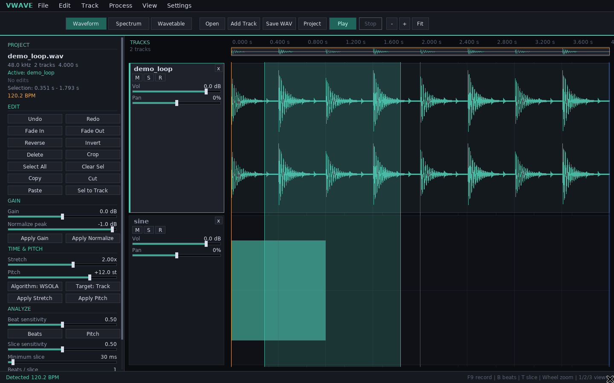
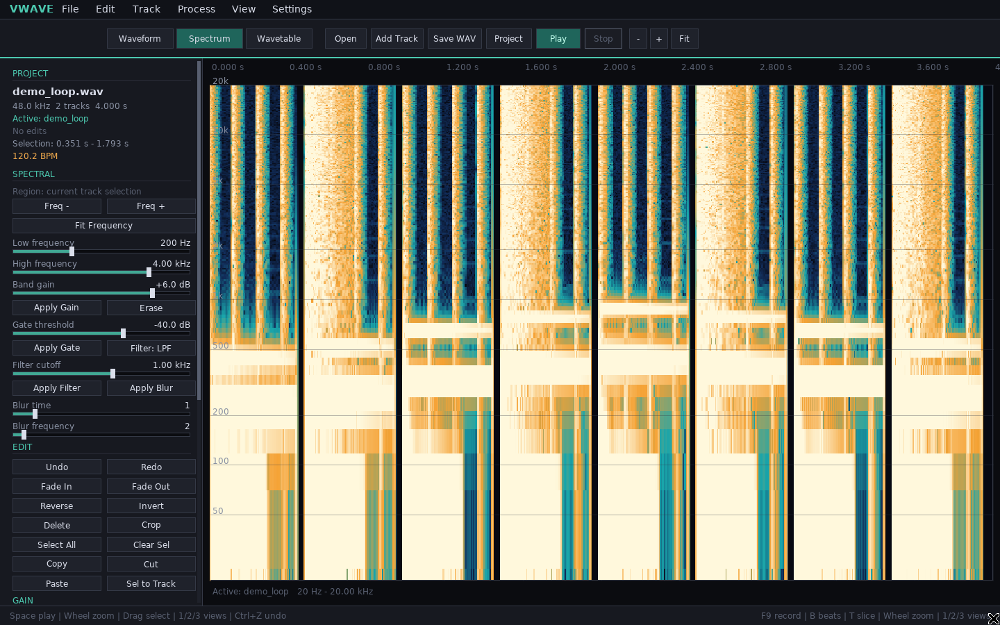
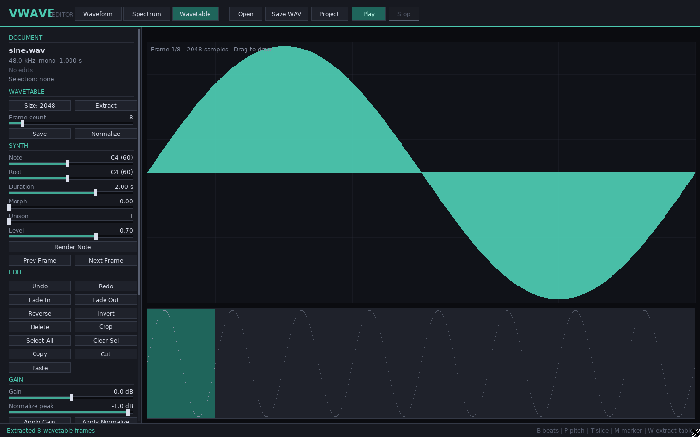

# VWaveEditor

[](https://github.com/tkleisas/VWaveEditor/actions/workflows/ci.yml)

A non-destructive multi-track wave editor, spectral workstation, wavetable lab,
synthesis sketchpad, and impulse-response capture tool. It runs as a standalone
desktop editor and as an embeddable editing core for
[YAWN](https://github.com/tkleisas/yawn).



## What works today

- **Multi-track editing**: layered waves with per-track mute, solo, record-arm,
  volume, pan, start offset, selection, and remove controls. Playback mixes all
  audible tracks, with solo and mute handled live.
- **Non-destructive editing**: immutable track sources, replayed edit history,
  exact undo/redo, clipboard, and timeline project persistence.
- **Waveform operations**: cut, copy, paste, insert, delete, crop, gain,
  normalize, fade in/out, reverse, invert, silence, DC removal, resample.
- **Time and pitch**: WSOLA and phase-vocoder time stretching, pitch shifting,
  and PaulStretch. Apply in place, preserving unselected audio around the
  selection, or render the processed selection to a new track at the same
  timeline position.
- **Analysis**: spectral-flux onsets, tempo/beat-grid detection, YIN pitch
  detection, transient slicing, and slice export with a JSON manifest.
- **Spectral editing**: STFT gain, Butterworth low/high-pass masks, spectral
  gating, blur, and time-frequency region editing. Independent time and
  log-frequency zoom.
- **Wavetables**: cycle extraction with pitch detection, harmonic construction,
  per-frame drawing, morphing, `.vwt` projects, WAV export/import, and offline
  wavetable-note rendering.
- **Recording**: arm a track, record from the configured input device at the
  playhead, and commit the take to the armed empty track or as a new take track.
  A lock-free ring buffer keeps capture off the UI allocation path.
- **Settings**: select audio input/output devices, choose dark/light themes,
  and persist settings under the XDG config directory.
- **Menus and parameter controls**: File/Edit/Track/Process/View/Settings menus
  plus draggable value sliders, selectors, and a scrollable inspector.
- **Track-aware automation**: Lua 5.4 scripting, a command-line interface, and
  an MCP stdio server using a shared timeline command layer. Scripts and agents
  can add/remove/select tracks, set routing, edit the active track, and render
  the mixdown.
- **Embedding**: UI-free C++17 core plus a stable C ABI for YAWN or other hosts.
- **Desktop editor**: SDL2/SDL2_ttf; waveform, spectrogram, and wavetable views;
  transport; beat grid; markers; slices; zoom; keyboard and drag editing.





## Build

Requirements:

- CMake 3.20+ and a C++17 compiler
- libsndfile
- SDL2 + SDL2_ttf for the standalone editor
- Lua 5.4 is vendored in `third_party/lua54`

Ubuntu:

```sh
sudo apt install build-essential cmake pkg-config libsndfile1-dev \
    libsdl2-dev libsdl2-ttf-dev
cmake -S . -B build -DCMAKE_BUILD_TYPE=Release
cmake --build build -j
ctest --test-dir build --output-on-failure
```

Core-only build:

```sh
cmake -S . -B build -DVWAVE_BUILD_GUI=OFF -DVWAVE_BUILD_CLI=OFF \
    -DVWAVE_BUILD_EXAMPLES=OFF
```

Build options:

| Option | Default | Purpose |
| --- | --- | --- |
| `VWAVE_BUILD_GUI` | `ON` | Standalone SDL2 editor |
| `VWAVE_BUILD_CLI` | `ON` | `vwave` command-line tool |
| `VWAVE_BUILD_TESTS` | `ON` | Test suite and CTest registration |
| `VWAVE_BUILD_LUA` | `ON` | Embedded Lua scripting |
| `VWAVE_BUILD_MCP` | `ON` | MCP server |
| `VWAVE_BUILD_EXAMPLES` | `ON` | Embedding examples |
| `VWAVE_WARNINGS_AS_ERRORS` | `OFF` | Strict compiler warnings |

Version numbers are derived from git tags (`vMAJOR.MINOR.PATCH`). The current
release is `v0.0.3`; untagged build trees fall back to `0.0.3`.

Artifacts land in `build/bin`:

```sh
./build/bin/vwave_editor recording.wav
./build/bin/vwave --help
```

### Prebuilt releases

Tagged releases are built and tested by GitHub Actions:

- Linux x86_64: `VWaveEditor-<tag>-linux-x64.tar.gz`
- Windows x86_64: `VWaveEditor-<tag>-windows-x64.zip` with the required
  MinGW runtime, SDL2, SDL2_ttf, and libsndfile DLLs bundled

See [Releasing](docs/RELEASING.md) for the workflow details.

## Quick start

Open the editor:

```sh
vwave_editor
```

Open a new project with `Ctrl+O`, drag audio in, or use **File → Open**. Use
**Add Track** / **File → Add Track** to layer additional waves. The track
headers provide mute (`M`), solo (`S`), record-arm (`R`), volume, and pan.
Drag a header or lane to make a track active.

Important controls:

| Key / control | Action |
| --- | --- |
| `Space` | Play/stop the mix |
| `1` / `2` / `3` | Waveform / spectrum / wavetable view |
| Wheel | Zoom time (waveform/spectrum) |
| `Ctrl`+wheel (spectrum) | Zoom displayed frequency range |
| Toolbar `-` / `+` / `Fit` | Time zoom |
| `F9` / Track → Record | Start/stop recording |
| `Ctrl+,` / Settings menu | Audio devices and theme |
| `B` | Detect tempo and beat grid |
| `P` | Detect pitch |
| `T` | Slice at transients |
| `E` | Export slices |
| `W` | Extract wavetable from the active track |
| `M` | Add marker at playhead |
| `N` | Normalize |
| `R` / `I` | Reverse / invert |
| `F` / `Shift+F` | Fade in / fade out |
| `Ctrl+Z` / `Ctrl+Y` | Undo / redo |
| `Ctrl+S` / `Ctrl+Shift+S` | Export mixdown / save project |

### Processing selections

The **Target: Track / New Track** selector applies to stretch and pitch:

- **Track** replaces the selected region with the processed audio, preserving
  the unselected prefix and suffix and changing the track length when stretching.
- **New Track** leaves the original untouched and adds the processed selection
  as a new layered track at the selection's timeline position.

**Edit → Selection to New Track** copies the raw selection to a new track for
further processing.

### Recording

Select an input device in **Settings**, arm a track with `R`, position the
playhead, then press `F9` or choose **Track → Record**. An empty armed track is
filled in place; recording to an already-populated armed track creates a new
take track so nothing is overwritten. The footer shows the recording duration.
See [Recording](docs/RECORDING.md).


### Settings

**Settings → Settings…** selects audio input/output devices and switches between
dark and light themes. Changes are saved immediately to
`$XDG_CONFIG_HOME/vwave/settings.json` (or `~/.config/vwave/settings.json`).
See [Settings](docs/SETTINGS.md).


## Command line

Process a file with any sequence of operations:

```sh
vwave process input.wav output.wav \
    --select 0.5 2.0 --normalize --fade-in --fade-out \
    --spectral-gate -45

vwave process input.wav stretched.wav \
    --select-all --stretch 2.0 --algorithm phase_vocoder

vwave analyze input.wav
vwave slices input.wav out/slices --mode transients
vwave wavetable input.wav table.vwt --frame-size 2048 --frame-count 16
vwave synth table.vwt note.wav --note 60 --duration 2
vwave sweep sweep.wav --seconds 5 --start-hz 20 --end-hz 20000
vwave deconvolve recorded.wav sweep.wav cabinet.wav --length 4096 --trim

vwave project info session.vwdoc
vwave project add-track session.vwdoc pad.wav --name Pad --start 0.5
vwave project set session.vwdoc 1 --gain -6 --pan -0.2 --mute
vwave project mixdown session.vwdoc mix.wav
```

The generic command surface is available directly:

```sh
vwave command gain '{"db":-6,"start":1.0,"end":2.0}' \
    --input in.wav --output out.wav
```

See [CLI reference](docs/CLI.md).

## Lua

```lua
vwave.load("/samples/break.wav")
vwave.select(0.0, 2.0)
vwave.normalize(-1.0)
vwave.apply("spectral_gate", { threshold_db = -45 })

local beats = vwave.analyze_beats()
vwave.apply("slices", { mode = "beats", bpm = beats.bpm })
vwave.export_slices("/samples/slices", "break")

vwave.map(0.0, 0.25, function(sample, frame, channel)
    return sample * 0.5
end)

vwave.add_track("/samples/pad.wav", "Pad", 0.5)
vwave.track_set(1, { gain_db = -6, pan = -0.2, muted = true })
vwave.select_track(0)
vwave.save_mixdown("/samples/mix.wav")
```

Run scripts from the CLI:

```sh
vwave lua edit.lua input.wav
```

See [Lua API](docs/LUA.md) and `examples/scripts/`.

## MCP

Run a local stdio MCP server:

```sh
vwave --mcp
```

Example client configuration:

```json
{
  "mcpServers": {
    "vwave": {
      "command": "/absolute/path/to/vwave",
      "args": ["--mcp"]
    }
  }
}
```

The server exposes document information, track management, loading/saving,
analysis, editing, spectral tools, wavetable tools, sweep/IR capture, and a
generic `vwave_command` tool. The session is also exposed as a resource at
`vwave://document/info`.

See [MCP tools](docs/MCP.md) for the tool catalog and protocol examples.

## Embedding in YAWN

The UI-free library is the intended integration point. Use `vwave::Timeline` for
a multi-track session and `vwave::Document` for individual tracks:

```cmake
set(VWAVE_BUILD_GUI OFF CACHE BOOL "" FORCE)
set(VWAVE_BUILD_CLI OFF CACHE BOOL "" FORCE)
add_subdirectory(../VWaveEditor VWaveEditor)
target_link_libraries(yawn_core PRIVATE vwave::core)
```

```cpp
vwave::Timeline timeline;
std::string error;
timeline.addAudioTrack("Lead", leadAudio, 0, &error);
timeline.addAudioTrack("Pad", padAudio, 0, &error);
timeline.setTrackGainDb(1, -6.0);
timeline.setTrackMuted(0, true);

const vwave::Audio mix = timeline.mixdown();
```

The timeline owns an independent non-destructive `Document` per track and keeps
per-track mute/solo/arm/gain/pan/offset state. For YAWN's fw2 UI, use
`Timeline`, `Document`, `computePeaks`, `computeSpectrogram`, and
`BeatAnalysis` directly. The SDL2 standalone editor is a reference frontend,
not a widget that can be parented inside YAWN's SDL3 window.

All editing happens on the control/UI thread. Snapshot rendered audio before
publishing it to an audio thread; neither `Timeline` nor `Document` is
thread-safe. A C ABI is available in `include/vwave/vwave_c.h` for hosts that
prefer an opaque timeline-backed handle and JSON commands.

See [Embedding guide](docs/EMBEDDING.md) and `examples/yawn_embed.cpp`.

## Architecture

```
SDL2 editor / CLI / Lua / MCP
              |
        Session command API
              |
          vwave_core
  Timeline: tracks, routing, mixdown
  Document: source + edit history
  DSP | analysis | spectral | wavetable
  synthesis | capture | recording buffer
```

- Track sources are never modified by an edit.
- Undo/redo replays a deterministic operation list for the active track.
- Timeline projects store every track, its history, selection, markers, slices,
  routing state, and the active track.
- The GUI streams multi-track playback directly from immutable track buffers
  with live mute/solo/gain/pan and on-the-fly rate conversion.
- Numeric DSP uses synthetic-signal tests (sines, impulses, click trains,
  chirps) rather than committed binary fixtures.
- The GUI does not own DSP state; track-aware operations are available to
  scripts and agents through the same Session command layer.

See [Architecture](docs/ARCHITECTURE.md) for the data model, algorithms, test
strategy, and known limitations.

## Status and roadmap

Version **0.0.3** includes the multi-track editing core, track-aware desktop
editor, recording, settings, CLI, Lua, MCP, C ABI, and the standalone editor
described above.

Deliberate remaining work:

- neural amp/instrument capture training and inference (linear IR capture is
  implemented; a capture-manifest backend is in place for future models)
- real-time preview of spectral edits
- VST3/AU effect hosting inside the editor
- multichannel UI beyond stereo
- performance work for multi-hour files and spectral jobs
- collaborative editing

The test-first development plan is in [docs/PLAN.md](docs/PLAN.md).

## License

MIT. See [LICENSE](LICENSE). Vendored and linked dependencies retain their own
licenses; see [NOTICES.md](NOTICES.md).
