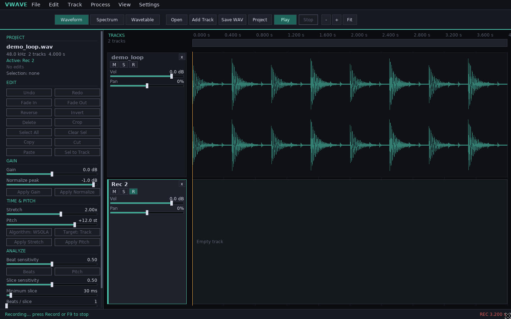

# Recording

VWaveEditor records from the audio input selected in **Settings**. The
standalone editor records at the current playhead and commits the take to the
timeline when recording stops.

## Workflow

1. Open **Settings** and choose the input device (and output device for
   playback).
2. Arm a track with its `R` button. Only one track is armed at a time.
3. Position the playhead.
4. Press `F9` or choose **Track → Record**.
5. Press `F9` / Record again to stop and commit the take.

The footer shows a red `REC` indicator and elapsed recording time.

## Take placement

- If no track is armed, a new empty track is created at the playhead and armed.
- If the armed track is empty, the take fills that track at the playhead.
- If the armed track already has audio, a new `<name> take` track is created so
  the existing audio is never overwritten.
- Recorded audio is resampled to the project sample rate when needed.

## Capture path

The SDL capture callback writes interleaved 32-bit float samples into a lock-free
SPSC ring buffer (`vwave::FloatRingBuffer`). The UI thread drains the ring into a
growable staging buffer once per frame. No file I/O or allocation occurs in the
capture callback.

If the capture ring fills because the UI is blocked, extra samples are dropped.
The audio thread never waits on the UI.

## Current limitations

- One recording target at a time.
- Input monitoring is not enabled.
- The capture path uses the system default channel count reported by SDL
  (stereo when available, mono fallback).
- Punch-in/out, loop recording, and take comping are future work.
