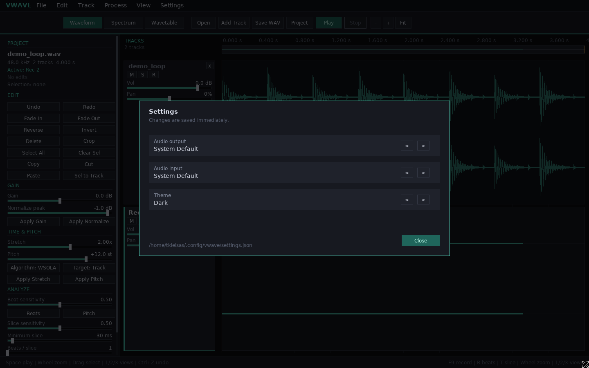

# Settings



Open **Settings → Settings…** or press `Ctrl+,`.

## Audio output

The selected output device is used for playback. Choosing a new device stops
playback, reopens the audio device, and falls back to the system default if the
selected device cannot be opened. Device names are discovered through SDL.

## Audio input

The selected input device is used the next time recording starts. Changing the
input while recording does not affect the current take. If opening the selected
input fails, the editor reports the failure and leaves the recording track
empty.

## Theme

Dark and light themes are available. The choice applies immediately to the
whole editor and is stored with the other settings.

## Persistence

Settings are stored at:

```text
$XDG_CONFIG_HOME/vwave/settings.json
```

or, when `XDG_CONFIG_HOME` is unset:

```text
~/.config/vwave/settings.json
```

The file is created on the first change. The format is versioned JSON:

```json
{
  "format": "vwave-settings",
  "version": 1,
  "inputDevice": "",
  "outputDevice": "",
  "theme": "dark"
}
```

An empty device name means the system default. Unknown or invalid themes fall
back to dark. Invalid or missing settings files are ignored in favor of safe
defaults.
